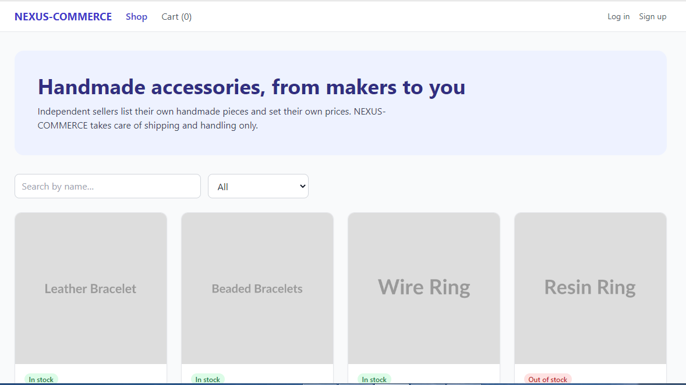
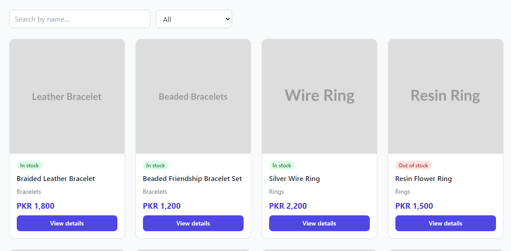
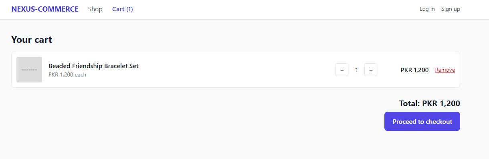
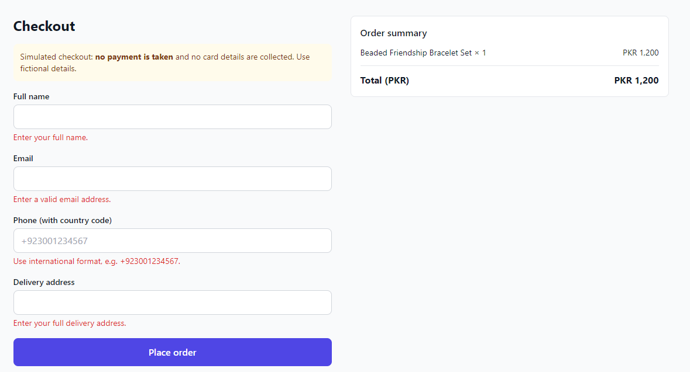

# NEXUS-COMMERCE (handmade accessories marketplace + mini CRM)

A student capstone for the GDGoC CUI Wah "Beyond Prompting" bootcamp. Independent sellers list handmade accessories, buyers browse and order, and a merchant dashboard tracks orders. **All data is fictional. No real payments, passwords or bank details.**

**Live demo:** https://nexus-commerce-elma-shah.vercel.app/
**Repository:** https://github.com/Elma-code/nexus-commerce-ElmaShah

## Problem
Small online sellers struggle to keep listings, customers and orders in one workflow. NEXUS-COMMERCE connects a customer storefront with a merchant dashboard. Sellers set their own prices and handle their customers; the platform handles shipping only.

## Features
**Storefront:** responsive product grid (image, name, price, stock badge), name search, category filter, product detail page with image gallery, cart (add, remove, change quantity, total), simulated checkout, order confirmation with order ID.
**Accounts (demo):** buyer and seller signup (name, phone, email, address; sellers also give a fictional bank account name and IBAN). Login is by email only.
**Sellers:** list products with 2 to 4 pictures, price (PKR), stock, category and description.
**Currency:** prices are PKR by default and convert to the buyer's currency from the country code in their phone number, using fixed approximate demo rates (not live).
**Merchant dashboard (`/admin`, seller accounts):** summary metrics (total orders, pending, revenue, customers), orders table with status dropdown and notes, customer list.
**Quality:** empty states, form validation, product-not-found and order-not-found pages, stock checks at checkout, responsive layout.

## Stack
React (Vite), Tailwind CSS v3, React Router. No backend.

## Prerequisites and run locally
Node.js 18 or newer.
```bash
cd frontend
npm install
npm run dev
```
Open the printed local URL (usually http://localhost:5173).

## Demo accounts
- Seller (sees the dashboard): `demo.seller@example.com` (no password)
- Buyers: check out as a guest, or sign up with fictional details.

## Persistence (honest scope)
Everything (products, accounts, cart, orders) is saved in the browser's **localStorage**. It is not shared between devices or browsers and is lost if browser data is cleared. Uploaded images are shrunk and stored in the browser. There are no passwords, so accounts are for demo only.

## Known limitations
- Exchange rates are fixed approximations, not live.
- The dashboard shows all orders to any seller account (a platform shipping view, not per-seller).
- No real authentication, payments or database.
- Starter products come from an AI-drafted dataset and use placeholder images; sellers upload real pictures for new products.

## Screenshots
| | |
|---|---|
| Home page |  |
| Home page (2) |  |
| Product details |  |
| Product not found |  |
| Cart |  |
| Checkout |  |
| Order placed |  |
| Order not found |  |
| Admin (1) |  |
| Admin (2) |  |

## Documentation
- AI prompt documentation: [prompts/INDEX.md](prompts/INDEX.md)
- [Architecture](docs/architecture.md) · [Testing](docs/testing.md) · [Deployment](docs/deployment.md)